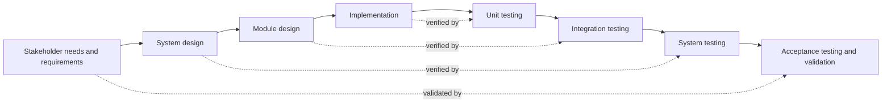
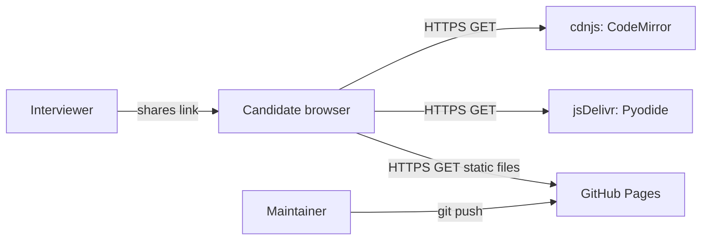
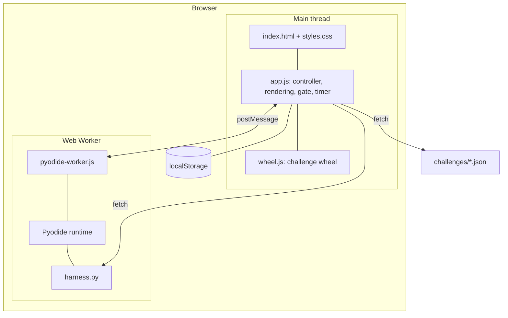
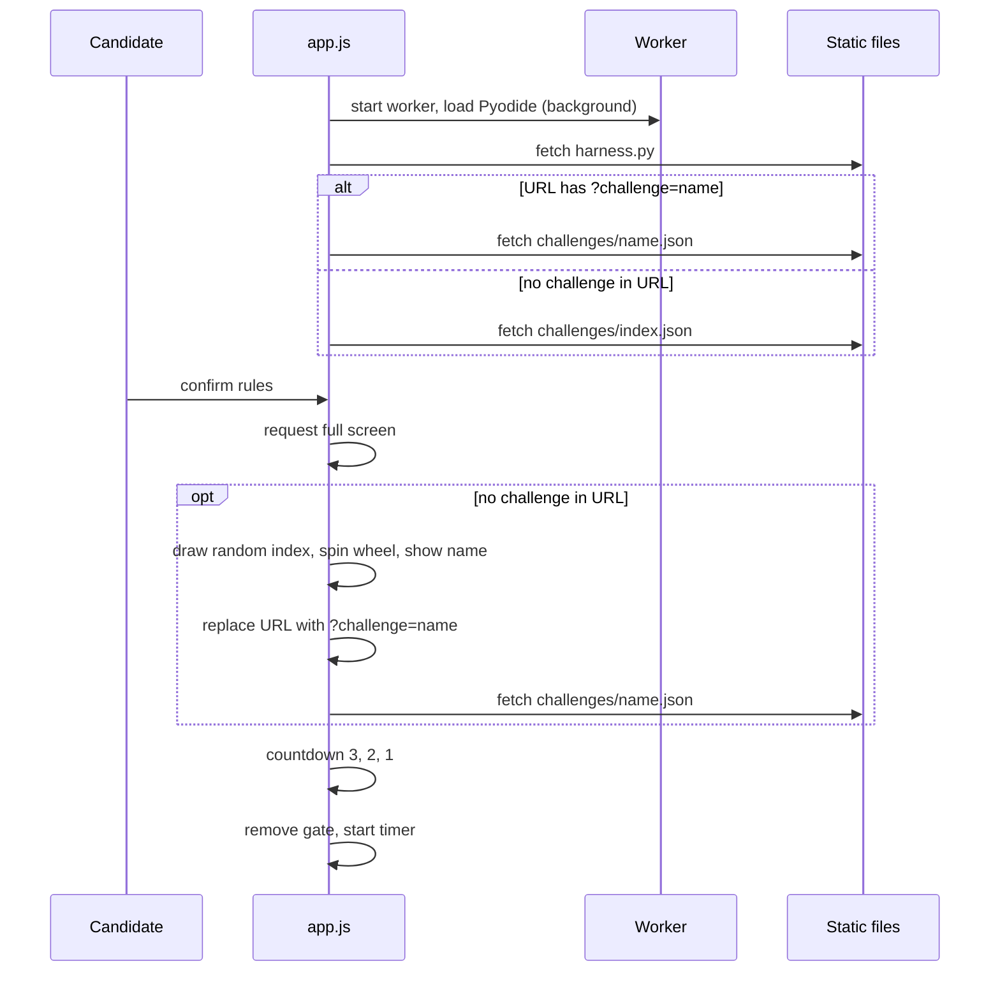
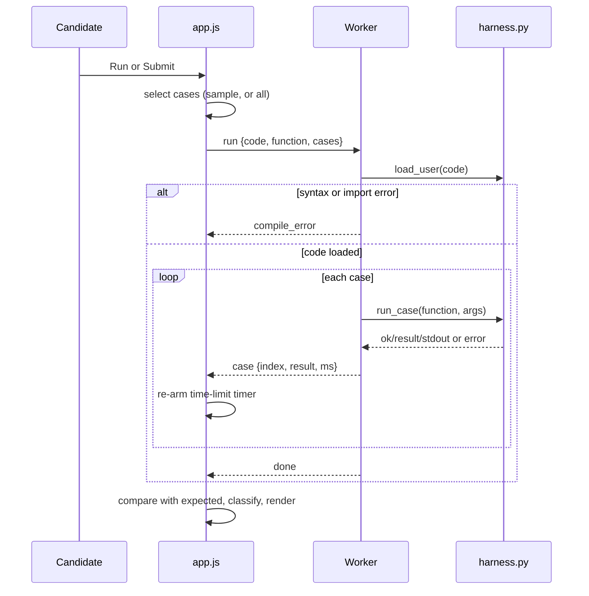

# Coding Interview Sandbox: V-Model Documentation

| Item | Value |
| --- | --- |
| Document ID | CIS-VM-001 |
| Version | 1.0 |
| Date | 2026-11-24 |
| Status | Draft for review |
| Product | Coding Interview Sandbox |
| Scope | Requirements, system design, module design, implementation, verification and validation |

## Table of contents

1. [Introduction](#1-introduction)
2. [V-model overview](#2-v-model-overview)
3. [Stakeholder needs and requirements](#3-stakeholder-needs-and-requirements)
4. [System design](#4-system-design)
5. [Module design](#5-module-design)
6. [Implementation](#6-implementation)
7. [Unit test specification](#7-unit-test-specification)
8. [Integration test specification](#8-integration-test-specification)
9. [System test specification](#9-system-test-specification)
10. [Acceptance test and validation](#10-acceptance-test-and-validation)
11. [Verification evidence to date](#11-verification-evidence-to-date)
12. [Requirements traceability matrix](#12-requirements-traceability-matrix)
13. [Risks, assumptions and limitations](#13-risks-assumptions-and-limitations)
14. [Configuration and change management](#14-configuration-and-change-management)
15. [Appendices](#15-appendices)

---

## 1. Introduction

### 1.1 Purpose

This document describes the Coding Interview Sandbox (the "System") along the V-model: what it must do (requirements), how it is structured (system and module design), how it is built (implementation), and how it is checked at each level (unit, integration, system and acceptance testing). Each design level is paired with a test level, and every requirement is traced to the tests that verify it.

### 1.2 Product summary

The System is a static web application for technical interviews. A candidate reads a programming problem, writes a Python solution in an in-browser editor, and runs it against sample and hidden test cases. Python executes in the candidate's browser through Pyodide (CPython compiled to WebAssembly). The System needs no application server, database or API key and is hosted as static files on GitHub Pages.

### 1.3 Intended readers

Interviewers and hiring managers (stakeholders), developers and maintainers, reviewers and testers.

### 1.4 Definitions

| Term | Meaning |
| --- | --- |
| Candidate | Person taking the assessment |
| Interviewer | Person who selects the challenge and reads the outcome |
| Challenge | One problem with its description, starter code and test cases, stored as one JSON file |
| Sample case | Test case with `hidden: false`; run by **Run** and **Submit** |
| Hidden case | Test case with `hidden: true`; run only by **Submit** |
| Verdict | Overall outcome of a run: Accepted, Wrong Answer, Runtime Error, Time Limit Exceeded or Compile Error |
| Pyodide | CPython compiled to WebAssembly, loaded from a CDN |
| Worker | Browser Web Worker thread that hosts Pyodide |
| Harness | Python module that executes the candidate's code once per test case |
| Gate | Rules-and-agreement screen shown before the assessment |

### 1.5 References

- Pyodide documentation: https://pyodide.org
- CodeMirror 5 documentation: https://codemirror.net/5/
- Sitemaps protocol: https://www.sitemaps.org
- Open Graph protocol: https://ogp.me
- Project README: [`../README.md`](../README.md)

---

## 2. V-model overview



| Design level (left) | Content | Test level (right) | Question answered |
| --- | --- | --- | --- |
| Stakeholder needs and requirements (section 3) | Needs, functional and non-functional requirements | Acceptance and validation (section 10) | Did we build the right product? |
| System design (section 4) | Architecture, interfaces, data, deployment | System test (section 9) | Does the whole system meet the requirements? |
| Module design (section 5) | Responsibilities and algorithms of each module | Integration test (section 8) | Do the modules work together? |
| Implementation (section 6) | Source code | Unit test (section 7) | Does each unit work as designed? |

Verification checks that the System is built correctly against its specification. Validation checks that the System fulfils the stakeholders' real needs.

---

## 3. Stakeholder needs and requirements

### 3.1 Stakeholders and operating context

| Stakeholder | Interest |
| --- | --- |
| Interviewer | A fair, repeatable way to assess Python problem-solving; low cost; easy to add problems |
| Candidate | A familiar, responsive environment with clear feedback |
| Maintainer | Simple deployment, small codebase, no operating cost |

Operating context: the candidate opens a link in a desktop browser, accepts the rules, works for the duration of the interview, and the interviewer reviews the outcome.

### 3.2 Stakeholder needs

| ID | Need |
| --- | --- |
| SN-01 | Present a problem in a layout familiar from common coding-practice sites |
| SN-02 | Let the candidate write and execute Python without installing anything |
| SN-03 | Evaluate the solution against tests the candidate has not seen |
| SN-04 | Discourage cheating and record the candidate's agreement to the rules |
| SN-05 | Show how long the candidate spent |
| SN-06 | Choose a specific problem, or pick one at random |
| SN-07 | Add and maintain problems without changing code |
| SN-08 | Host at no cost with no server to operate |
| SN-09 | Be professional and discoverable (branding, metadata, search indexing) |

### 3.3 Functional requirements

Priority: M = must, S = should.

| ID | Requirement | Need | Pri |
| --- | --- | --- | --- |
| FR-01 | The System shall display the challenge title, description, examples, constraints and optional follow-up note. | SN-01 | M |
| FR-02 | The System shall provide a Python code editor with line numbers, syntax highlighting, indentation with the Tab key, and automatic saving of the code in the browser per challenge. | SN-01, SN-02 | M |
| FR-03 | The System shall execute the candidate's code against the sample cases when the candidate selects **Run** (also by Ctrl+Enter or Cmd+Enter). | SN-02 | M |
| FR-04 | The System shall execute the candidate's code against all cases, sample and hidden, when the candidate selects **Submit**. | SN-03 | M |
| FR-05 | The System shall report one verdict per run: Accepted, Wrong Answer, Runtime Error, Time Limit Exceeded or Compile Error, and shall show for the failing case the input, the actual output or error, the expected value and the captured standard output. | SN-02, SN-03 | M |
| FR-06 | The System shall enforce a time limit per test case (default 5000 ms, configurable per challenge) and shall terminate a run that exceeds it without freezing the page. | SN-02 | M |
| FR-07 | The System shall open a specific challenge when the address contains `?challenge=<name>`, and shall not show the wheel in that case. | SN-06 | M |
| FR-08 | When no challenge is named, the System shall pick a challenge at random, show a spinning wheel that stops on it, and update the address so that a reload keeps the same challenge. | SN-06 | M |
| FR-09 | The System shall show a rules-and-agreement screen, require an explicit confirmation, and then show a 3-2-1 countdown before the assessment screen. | SN-04 | M |
| FR-10 | The System shall request full-screen mode when the candidate confirms the rules. | SN-04 | S |
| FR-11 | The System shall show a count-up timer that starts when the countdown ends, survives a page reload, and restarts when the stored start time is older than 12 hours. | SN-05 | M |
| FR-12 | The System shall present resizable panes with a default width of 40% for the description and 60% for the code area. | SN-01 | M |
| FR-13 | The System shall prevent the candidate from selecting, copying, cutting, dragging or opening the context menu on the problem statement. | SN-04 | S |
| FR-14 | The System shall load challenges from JSON files listed in `challenges/index.json`, so that adding a challenge requires no code change. | SN-07 | M |
| FR-15 | The System shall support an optional `compare: "unordered"` setting that accepts list answers in any order. | SN-03, SN-07 | S |
| FR-16 | The System shall allow the candidate to restore the starter code after confirmation. | SN-02 | S |
| FR-17 | The System shall show a copyright notice linking to the owner's site, and shall hide it in full-screen mode. | SN-09 | S |

### 3.4 Non-functional requirements

| ID | Category | Requirement |
| --- | --- | --- |
| NFR-01 | Architecture | The System shall consist of static files only and shall need no server-side code, database or credentials. |
| NFR-02 | Compatibility | The System shall work in current versions of Chrome, Edge, Firefox and Safari on Windows, macOS and Linux. Support for phones is out of scope. |
| NFR-03 | Performance | After the first load, a Run on a sample set shall complete within the per-case time limit; Python shall be ready within 30 seconds on a 20 Mbit/s connection (about 10 MB first download, then cached). |
| NFR-04 | Responsiveness | A candidate program that loops forever shall not make the page unresponsive, and shall be reported within the time limit plus 1 second. |
| NFR-05 | Security | The System shall escape all challenge and result text before rendering, shall accept challenge names only of the pattern `[A-Za-z0-9_-]+`, and shall run candidate code only inside the browser sandbox. |
| NFR-06 | Privacy | The System shall not use cookies, analytics or server-side storage. Candidate code and timer values stay in the candidate's browser. |
| NFR-07 | Maintainability | Markup, styles, logic, worker, harness and data shall be in separate files; challenge data shall be separate from code. |
| NFR-08 | Discoverability | The page shall provide description, robots, canonical, Open Graph, Twitter and JSON-LD metadata, a sitemap, a `robots.txt` that allows indexing, and a favicon set. |
| NFR-09 | Usability | Controls shall be labelled in plain English; the result panel shall always state the verdict first. |
| NFR-10 | Portability | The System shall not depend on the operating system of the host or the client. |
| NFR-11 | Licensing | The source shall be released under the MIT License. |

### 3.5 Constraints and assumptions

- C-01: Hosting is GitHub Pages (static files, HTTPS, no server code).
- C-02: Candidate code is Python 3 only.
- C-03: Third-party code (Pyodide, CodeMirror) is loaded from public CDNs.
- A-01: The candidate has a desktop browser with JavaScript and WebAssembly enabled and Internet access to the CDNs.
- A-02: The interview is conducted in good faith; the rules screen is an honor-system control.

---

## 4. System design

### 4.1 Context



The System has no outbound data flow from the candidate's browser other than fetching files. Test execution and result calculation happen locally.

### 4.2 Architecture



Architectural style: client-side single-page application with a data-driven content layer and an isolated execution layer.

| Layer | Components | Responsibility |
| --- | --- | --- |
| Presentation | `index.html`, `assets/css/styles.css` | Layout, gate, panes, result panel, metadata |
| Application | `assets/js/app.js`, `assets/js/wheel.js` | Challenge loading, editor, run orchestration, verdicts, timer, gate, resizing |
| Execution | `assets/js/pyodide-worker.js`, `assets/python/harness.py` | Isolated Python execution per test case |
| Data | `challenges/index.json`, `challenges/<name>.json` | Problem statements and test cases |
| Delivery | GitHub Pages, `robots.txt`, `sitemap.xml`, `site.webmanifest` | Hosting and discoverability |

### 4.3 Key design decisions

| ID | Decision | Rationale | Alternative rejected |
| --- | --- | --- | --- |
| DD-01 | Run Python in the browser with Pyodide | Satisfies NFR-01 and C-01: no backend, no cost, no code-execution attack surface on a server | Server-side runner (cost, security, operations) |
| DD-02 | Host Pyodide in a Web Worker | Allows a runaway program to be killed by terminating the worker (FR-06, NFR-04) | Main-thread execution (page freezes) |
| DD-03 | One JSON file per challenge plus an index file | Adds challenges without code changes (FR-14); GitHub Pages cannot list directories | Hard-coded problems; a single large file |
| DD-04 | Compare results as JSON values | Language-independent and deterministic; supports lists, numbers and booleans | Text comparison of printed output |
| DD-05 | Per-case messages from worker to page | The timer can be re-armed after each case, so the limit applies per case, and partial results survive a timeout | One message with all results |
| DD-06 | Restart the worker after a timeout | Guarantees a clean interpreter after an aborted run | Reuse the stuck worker |
| DD-07 | Use `class Solution` with a named method, same as common practice sites | Familiar to candidates (SN-01); a top-level function is also accepted | Stdin and stdout programs |
| DD-08 | Store the selection in the address after the wheel picks | A reload cannot re-roll the question | Keep the selection only in memory |
| DD-09 | Timer based on a stored start timestamp | Survives reload and tab throttling | `setInterval` counter |
| DD-10 | Plain JavaScript, no build step | Smallest toolchain; files are served as written (NFR-07) | Framework and bundler |

### 4.4 Runtime behaviour

#### 4.4.1 Start-up and gate



#### 4.4.2 Run and Submit



If the timer expires, the page terminates the worker, starts a new one, and reports Time Limit Exceeded for the case in progress; later cases are shown as not run.

### 4.5 Verdict logic

1. A load error (syntax error, missing import) gives **Compile Error**.
2. Otherwise each case gets a state: `pass` (value equals expected), `wrong`, `error` (exception raised), `tle` or `skipped`.
3. The verdict is derived from the first case that is not `pass` or `skipped`: `wrong` gives Wrong Answer, `error` gives Runtime Error, `tle` gives Time Limit Exceeded. If there is none, the verdict is Accepted.

### 4.6 Data design

#### 4.6.1 Challenge file

| Field | Type | Required | Description |
| --- | --- | --- | --- |
| `id` | integer | no | Reference number |
| `title` | string | yes | Heading |
| `difficulty` | string | no | Kept for reference; not displayed |
| `description` | string[] | yes | Paragraphs; backticks and `**bold**` supported |
| `examples` | object[] | yes | `{input, output, explanation?}` |
| `constraints` | string[] | yes | Constraint list |
| `followUp` | string | no | Note under the constraints |
| `compare` | string | no | `"unordered"` |
| `function` | string | yes | Method the candidate implements |
| `params` | string[] | yes | Parameter names used to label inputs |
| `starterCode` | string | yes | Initial editor content |
| `timeLimitMs` | integer | no | Per-case limit, default 5000 |
| `testcases` | object[] | yes | `{args: any[], expected: any, hidden: boolean}` |

#### 4.6.2 Index file

`challenges/index.json` is an array of challenge file names without the `.json` extension. The order is the wheel order.

#### 4.6.3 Browser storage

| Key | Value | Purpose |
| --- | --- | --- |
| `code:<name>` | string | Saved editor content |
| `start:<name>` | epoch milliseconds | Timer start; ignored when older than 12 hours or in the future |

All storage access is wrapped in `try/catch`, so the page works when storage is blocked.

### 4.7 Interface design

#### 4.7.1 Main thread and worker messages

| Direction | Message | Payload | Meaning |
| --- | --- | --- | --- |
| Page to worker | `init` | `harness` (Python source) | Load Pyodide and the harness |
| Page to worker | `run` | `code`, `fn`, `cases` | Execute the cases |
| Worker to page | `ready` | none | Python is ready |
| Worker to page | `case` | `i`, `r`, `ms` | Result of one case |
| Worker to page | `done` | none | All cases finished |
| Worker to page | `compile_error` | `message` | The submitted code could not be loaded |
| Worker to page | `fatal` | `message` | Unexpected failure |

#### 4.7.2 Harness interface

| Function | Input | Output |
| --- | --- | --- |
| `load_user(code)` | Python source | none; raises on syntax or import error |
| `run_case(fn, args_json)` | Function name, JSON array of arguments | JSON object `{ok, result, stdout}` or `{ok:false, error, stdout}` |

#### 4.7.3 External interfaces

| Interface | Direction | Notes |
| --- | --- | --- |
| Pyodide v0.26.4 from jsDelivr | inbound | `pyodide.js`, WebAssembly and standard library |
| CodeMirror 5.65.16 from cdnjs | inbound | Editor, Python mode, `material-darker` theme |
| Fullscreen API | browser | Standard and `webkit`-prefixed forms |
| Web Storage API | browser | `localStorage` |

### 4.8 Security design

| Threat | Control |
| --- | --- |
| Script injection through challenge text or results | All text is HTML-escaped before it is rendered; only backtick and bold markers are converted afterwards |
| Path traversal through `?challenge=` | The name must match `^[A-Za-z0-9_-]+$` and is used only inside `challenges/<name>.json` |
| Malicious or runaway candidate code | Runs in WebAssembly inside a Web Worker in the candidate's own browser; terminated at the time limit |
| Copying of the problem text | Selection, copy, cut, drag and context menu are blocked on the statement panel |
| Reading hidden tests | Not prevented: tests are static files (see section 13) |
| Re-rolling the random question | The chosen name is written to the address |

### 4.9 Deployment design

- Source in a public GitHub repository; branch `main`, folder root.
- Published with GitHub Pages; `.nojekyll` makes Pages serve the files unchanged.
- No build, no environment variables, no secrets.
- Address: `https://ainlamyae.github.io/coding-interview-sandbox/`.
- `robots.txt` allows all crawlers and references `sitemap.xml`; `404.html` is served for unknown paths.

### 4.10 Quality attribute strategies

| Attribute | Strategy |
| --- | --- |
| Reliability | Worker isolation and restart; storage access guarded |
| Performance | Pyodide loads in the background behind the gate; challenge JSON is fetched once |
| Maintainability | Separation of markup, style, logic, worker, harness and data |
| Portability | Standard web APIs only; vendor-prefixed fallbacks for Safari full screen |
| Observability | Status text shows Python load state; errors are displayed in the page |

---

## 5. Module design

### 5.1 Module overview

| Module | File | Approx. lines | Responsibility |
| --- | --- | --- | --- |
| M-01 Page | `index.html` | 123 | Structure, metadata, script loading |
| M-02 Styles | `assets/css/styles.css` | 87 | Theme, layout, gate, wheel, footer, timer |
| M-03 Controller | `assets/js/app.js` | 324 | Challenge loading, editor, execution control, results, timer, gate, resizing |
| M-04 Wheel | `assets/js/wheel.js` | 55 | Draw and animate the wheel, stop on a target |
| M-05 Worker | `assets/js/pyodide-worker.js` | 31 | Host Pyodide, relay messages |
| M-06 Harness | `assets/python/harness.py` | 27 | Execute candidate code per case |
| M-07 Data | `challenges/*.json` | n/a | Problems and tests |
| M-08 Site files | `robots.txt`, `sitemap.xml`, `site.webmanifest`, `404.html` | n/a | Discoverability and error page |

### 5.2 M-03 Controller: functional units

| Unit | Responsibility | Requirements |
| --- | --- | --- |
| `loadProblem(name)` | Validate the name, fetch the JSON, render the description and editor | FR-01, FR-07, FR-14, NFR-05 |
| `listChallenges()`, `prettyName(slug)` | Read `index.json`; convert `top-k-frequent-elements` to "Top K Frequent Elements" | FR-08, FR-14 |
| `renderDescription()` | Build the statement HTML from escaped fields | FR-01, NFR-05 |
| `initEditor()` | Create the CodeMirror editor, restore saved code, bind shortcuts; fall back to a text area when CodeMirror is missing | FR-02, FR-03 |
| `startWorker()`, `execute(cases)` | Create the worker, send cases, arm and re-arm the time-limit timer, restart on timeout | FR-06, NFR-04 |
| `run(mode)` | Select cases, call `execute`, compute states and verdict, render | FR-03, FR-04, FR-05 |
| `sameValue(a, b)` | Compare actual and expected values (ordered, or unordered when configured) | FR-05, FR-15 |
| `renderBottom()`, `inputBlocks()`, `fmtArg()` | Render the Testcase and Test Result tabs; truncate values over 600 characters | FR-05, NFR-09 |
| `pickWithWheel()` | Draw an index with `crypto.getRandomValues`, run the wheel, update the URL, load the challenge | FR-08 |
| `enterFullscreen()` | Use the standard or `webkit` API, ignore refusal | FR-10 |
| `startTimer()` | Store or read the start time, format and display elapsed time | FR-11 |
| `drag(handle, onMove)` | Pane resizing with pointer capture | FR-12 |
| Gate handler | Confirm, full screen, optional wheel, countdown, remove gate | FR-09 |

### 5.3 M-04 Wheel: design

- Input: canvas, label list, target index, duration.
- The wheel has `n` equal segments. The pointer is fixed at the top. The final rotation is `-π/2 - (target + 0.5) × segment + jitter + 6 full turns`, so the target segment ends under the pointer.
- Rotation follows an ease-out cubic curve. A random jitter of up to ±30% of a segment makes the stop look natural without leaving the segment.
- Output: a promise that resolves when the animation ends.

### 5.4 M-05 Worker: design

- On `init`: load Pyodide from the CDN, execute the harness, send `ready`.
- On `run`: call `load_user`; on exception send `compile_error` (traceback lines filtered to the user's frames). Otherwise call `run_case` for each case, send one `case` message per case with the elapsed milliseconds, then `done`.
- Any unexpected exception sends `fatal`.

### 5.5 M-06 Harness: design

- `load_user(code)` compiles and executes the code in a fresh namespace named `__main__`.
- `run_case(fn, args_json)`:
  1. Decode the arguments.
  2. Resolve the target: `Solution().<fn>` if class `Solution` exists, otherwise the top-level function `<fn>`, otherwise raise `NameError` with a hint.
  3. Call it with standard output redirected into a buffer.
  4. Return the result as JSON; on any exception return the traceback limited to 12 lines with harness frames removed.
- Results must be JSON-serializable.

### 5.6 M-07 Data: design rules

- Each challenge has at least one sample case and several hidden cases that cover minimum and maximum sizes, boundary values, disconnected or degenerate structures, and ordering variants.
- Every `expected` value is computed by an independent reference solution; inputs respect the stated constraints.
- Where several answers are valid, `compare` is set accordingly.

### 5.7 Initial challenge bank

| Challenge | Function | Sample | Hidden | Total |
| --- | --- | --- | --- | --- |
| Number of Islands | `numIslands` | 3 | 19 | 22 |
| Course Schedule | `canFinish` | 3 | 18 | 21 |
| Graph Valid Tree | `validTree` | 3 | 21 | 24 |
| Meeting Rooms | `canAttendMeetings` | 3 | 20 | 23 |
| Top K Frequent Elements | `topKFrequent` | 3 | 19 | 22 |
| Task Scheduler | `leastInterval` | 3 | 21 | 24 |
| **Total** | | **18** | **118** | **136** |

---

## 6. Implementation

### 6.1 Technology stack

| Concern | Choice | Version |
| --- | --- | --- |
| Markup and styling | HTML5, CSS3 | n/a |
| Application logic | JavaScript (ES2020, no transpilation) | n/a |
| Python runtime | Pyodide | 0.26.4 |
| Editor | CodeMirror | 5.65.16 |
| Data format | JSON | n/a |
| Hosting | GitHub Pages | n/a |
| Version control | Git | n/a |

### 6.2 Repository structure

```
.
├── index.html
├── 404.html
├── favicon.ico
├── site.webmanifest
├── robots.txt
├── sitemap.xml
├── LICENSE
├── README.md
├── .editorconfig  .gitignore  .nojekyll
├── assets/
│   ├── css/styles.css
│   ├── js/{app.js, wheel.js, pyodide-worker.js}
│   ├── python/harness.py
│   └── img/ (favicon.svg, PNG icons, og-image.png)
├── challenges/
│   ├── index.json
│   └── <name>.json (6 files)
└── docs/V-MODEL.md
```

### 6.3 Implementation rules

| Rule | Detail |
| --- | --- |
| Style | `.editorconfig`: UTF-8, LF line endings, two-space indentation (four for Python) |
| Safety | Escape before render; strict mode (`"use strict"`); guarded storage access |
| Separation | No inline logic in HTML except the structured-data block; data never embedded in code |
| Compatibility | Standard APIs; `webkit` fallback for full screen; `-webkit-user-select` |
| Dependencies | Only two third-party libraries, pinned to exact versions |
| Naming | Challenge files use lowercase kebab case matching the name used in the address |

### 6.4 Build and release

There is no build step. A release is a commit on `main`; GitHub Pages publishes the files. Before release the maintainer runs the checks in section 11.

### 6.5 Procedure: adding a challenge

1. Copy an existing challenge file and rename it.
2. Edit the fields (section 4.6.1); compute every `expected` value with a reference solution.
3. Add the name to `challenges/index.json`.
4. Open the page with `?challenge=<name>` and run test ST-12 (correct solution accepted, wrong solution rejected).

---

## 7. Unit test specification

Level: individual functions and modules in isolation. Pairs with the implementation (section 6).

Status values: **Verified (static)** = evidenced by file analysis (section 11); **Planned** = specified, not yet executed.

| ID | Unit | Test objective | Input | Expected result | Req. | Status |
| --- | --- | --- | --- | --- | --- | --- |
| UT-01 | `harness.run_case` | Return value of a method | Valid `Solution`, simple args | `{ok:true, result:<value>}` | FR-03 | Planned |
| UT-02 | `harness.run_case` | Standard output capture | Code that prints | `stdout` contains the printed text | FR-05 | Planned |
| UT-03 | `harness.run_case` | Exception handling | Code that raises | `{ok:false, error:<traceback>}`; harness frames removed; at most 12 lines | FR-05 | Planned |
| UT-04 | `harness.run_case` | Top-level function fallback | Function defined without a class | Function is called | FR-03 | Planned |
| UT-05 | `harness.run_case` | Missing function | Code without the required name | `NameError` hint in `error` | FR-05 | Planned |
| UT-06 | `harness.load_user` | Syntax error | `def f(:` | Raises; page shows Compile Error | FR-05 | Planned |
| UT-07 | `sameValue` | Ordered comparison | `[1,2]` vs `[2,1]` | Not equal | FR-05 | Planned |
| UT-08 | `sameValue` | Unordered comparison | `compare:"unordered"`, `[1,2]` vs `[2,1]` | Equal | FR-15 | Planned |
| UT-09 | `sameValue` | Type strictness | `1` vs `true`, `"1"` vs `1` | Not equal | FR-05 | Planned |
| UT-10 | `prettyName` | Slug conversion | `top-k-frequent-elements` | `Top K Frequent Elements` | FR-08 | Planned |
| UT-11 | `fmtArg` | Truncation | Value over 600 characters | Truncated with length note | NFR-09 | Planned |
| UT-12 | `loadProblem` | Name validation | `../x`, `a b`, empty | Rejected with "invalid challenge name"; no fetch | NFR-05 | Planned |
| UT-13 | `esc`, `inline` | Escaping | `<script>x</script>`, `` `a<b` `` | Output contains `&lt;`; no raw tag | NFR-05 | Planned |
| UT-14 | `startTimer` | Start-time rules | Missing, future and older-than-12-hours values | Start time reset to now | FR-11 | Planned |
| UT-15 | `startTimer` | Format | 59 s, 3 600 s, 3 661 s | `00:59`, `1:00:00`, `1:01:01` | FR-11 | Planned |
| UT-16 | `spinWheel` | Landing position | Each index 0 to n-1 | Final angle places the target segment under the pointer | FR-08 | Planned |
| UT-17 | Challenge schema | Required fields and types | Every challenge file | All required fields present; `args` is an array; `hidden` is boolean | FR-14 | Verified (static) |
| UT-18 | Challenge data | Expected values | Every test case | Matches an independent reference solution; inputs within the stated constraints | FR-04 | Verified (static) |
| UT-19 | JavaScript sources | Syntax | `app.js`, `wheel.js`, `pyodide-worker.js` | Parse without errors | NFR-07 | Verified (static) |
| UT-20 | Site files | Well-formedness | `site.webmanifest`, `challenges/index.json`, `sitemap.xml`, JSON-LD block | Parse without errors | NFR-08 | Verified (static) |

Exit criterion: all unit tests pass, with no open defect of severity high.

---

## 8. Integration test specification

Level: interaction between modules and with external services. Pairs with module design (section 5).

| ID | Interface under test | Objective | Procedure | Expected result | Req. | Status |
| --- | --- | --- | --- | --- | --- | --- |
| IT-01 | Page and worker | Start-up handshake | Load the page; watch status text | "Loading Python…" then "Python ready"; `ready` received | NFR-03 | Planned |
| IT-02 | Page and harness file | Harness delivery | Block `harness.py`; load page | Status "Python failed to load"; page does not crash | NFR-09 | Planned |
| IT-03 | Page, worker, harness | Successful run | Correct solution; **Run** | Per-case messages then `done`; verdict Accepted | FR-03 | Planned |
| IT-04 | Page, worker | Compile error path | Syntax error; **Run** | `compile_error`; verdict Compile Error; no case rows | FR-05 | Planned |
| IT-05 | Page, worker | Runtime error path | Code raising in a case | Verdict Runtime Error; traceback shown | FR-05 | Planned |
| IT-06 | Page, worker | Time-limit path | `while True: pass`; **Run** | Within the limit plus 1 s: worker restarted, verdict Time Limit Exceeded; later cases Not run | FR-06, NFR-04 | Planned |
| IT-07 | Page, worker | Recovery after timeout | Run an endless loop, then a correct solution | Second run is Accepted (fresh interpreter) | FR-06 | Planned |
| IT-08 | Page and challenge loader | Fixed challenge | Open `?challenge=task-scheduler` | That challenge loads; no wheel | FR-07 | Planned |
| IT-09 | Page and challenge loader | Unknown challenge | Open `?challenge=missing` | Error message with server hint; page does not crash | FR-07 | Planned |
| IT-10 | Page, index, wheel | Random selection | Open the page without a parameter; confirm rules | Wheel spins, stops on a name from `index.json`; URL updated; challenge loads | FR-08 | Planned |
| IT-11 | Page and address bar | Reload after wheel | Reload after IT-10 | Same challenge, no wheel | FR-08 | Planned |
| IT-12 | Page and `localStorage` | Code persistence | Type code; reload | Code restored; Reset restores starter code | FR-02, FR-16 | Planned |
| IT-13 | Page and `localStorage` | Storage blocked | Disable site storage; use the page | Page works; nothing is saved | NFR-06 | Planned |
| IT-14 | Page and Fullscreen API | Full screen on confirm | Confirm rules | Full screen entered (or refused silently); copyright hidden in full screen | FR-10, FR-17 | Planned |
| IT-15 | Page and CDN | CodeMirror unavailable | Block the CodeMirror host | Plain text-area fallback; Run still works | FR-02 | Planned |
| IT-16 | Page and CDN | Pyodide unavailable | Block jsDelivr | "Python failed to load"; Run reports a clear error | NFR-09 | Planned |
| IT-17 | Page and challenge data | Index consistency | Compare `index.json` with the files | Every listed name has a file; every file is listed | FR-14 | Verified (static) |

Exit criterion: all integration tests pass; every message type in section 4.7.1 has been exercised.

---

## 9. System test specification

Level: the complete System in a real browser, against the system requirements and design (sections 3 and 4).

### 9.1 Functional system tests

| ID | Scenario | Steps | Expected result | Req. | Status |
| --- | --- | --- | --- | --- | --- |
| ST-01 | Layout | Open the page and accept the rules | Description about 40% and code area about 60% of the width; editor above, Testcase and Test Result below | FR-01, FR-12 | Planned |
| ST-02 | Pane resizing | Drag both dividers | Panes resize within limits; editor refreshes | FR-12 | Planned |
| ST-03 | Statement content | Open each challenge | Title, description, examples, constraints and follow-up (where present) shown; no difficulty label | FR-01 | Planned |
| ST-04 | Rules gate | Open; do not confirm | Assessment is not reachable; button is the only way forward | FR-09 | Planned |
| ST-05 | Countdown | Confirm | 3, 2, 1 shown, then the assessment screen | FR-09 | Planned |
| ST-06 | Timer | Wait 65 s; reload; wait | Shows `01:05`, then continues from the stored start after reload | FR-11 | Planned |
| ST-07 | Timer expiry | Set a stored start older than 12 hours; reload | Timer restarts from `00:00` | FR-11 | Planned |
| ST-08 | Run, accepted | Correct solution; **Run** | Verdict Accepted; "n / n sample cases passed" | FR-03, FR-05 | Planned |
| ST-09 | Run, wrong | Wrong solution; **Run** | Verdict Wrong Answer; input, output, expected shown | FR-05 | Planned |
| ST-10 | Submit, hidden failure | Solution correct on samples only; **Submit** | Wrong Answer; "Failed on testcase k (hidden)"; counts shown | FR-04, FR-05 | Planned |
| ST-11 | Submit, accepted | Correct solution; **Submit** | Accepted; "n / n testcases passed" and runtime | FR-04 | Planned |
| ST-12 | New-challenge check | For each challenge: submit a correct solution, then a wrong one | Correct is Accepted; wrong is rejected | FR-14 | Planned |
| ST-13 | Unordered answer | Top K Frequent Elements: return the answer in reverse order | Accepted | FR-15 | Planned |
| ST-14 | Statement protection | Select with mouse, Ctrl+A, Ctrl+C, right-click, drag on the statement | No selection, no copy, no menu | FR-13 | Planned |
| ST-15 | Shortcut | Press Ctrl+Enter (Windows, Linux) and Cmd+Enter (macOS) in the editor | Run starts | FR-03 | Planned |
| ST-16 | Copyright notice | View in a normal window, then full screen | Shown with a link and no underline; hidden in full screen | FR-17 | Planned |
| ST-17 | Verdict order | Cause each verdict type | Verdict text is shown first in the result panel | NFR-09 | Planned |

### 9.2 Non-functional system tests

| ID | Attribute | Procedure | Pass criterion | Req. | Status |
| --- | --- | --- | --- | --- | --- |
| ST-20 | Performance | Cold load on a 20 Mbit/s link; measure time to "Python ready" | 30 s or less; warm cache noticeably faster | NFR-03 | Planned |
| ST-21 | Responsiveness | Run `while True: pass` and interact with the page | Page stays responsive; Time Limit Exceeded within the limit plus 1 s | NFR-04 | Planned |
| ST-22 | Maximum input | Submit a linear-time solution to each challenge | Accepted within 5 s per case | NFR-03 | Planned |
| ST-23 | Compatibility | Repeat ST-05, ST-08, ST-11 on Chrome, Edge, Firefox (Windows, macOS, Linux) and Safari (macOS) | All pass | NFR-02, NFR-10 | Planned |
| ST-24 | Injection | Put `` in a test challenge title and a candidate `print` | Rendered as text; no script runs | NFR-05 | Planned |
| ST-25 | Path handling | Open `?challenge=../README`, `?challenge=a/b` | "invalid challenge name"; no request outside `challenges/` | NFR-05 | Planned |
| ST-26 | Privacy | Inspect cookies and network requests | No cookies; only requests to the host, jsDelivr and cdnjs | NFR-06 | Planned |
| ST-27 | Discoverability | Validate head metadata, `robots.txt`, `sitemap.xml`, manifest and favicons with standard validators | No errors; robots allows indexing; canonical and sitemap addresses are consistent | NFR-08 | Planned |
| ST-28 | Error page | Open an unknown path on the live site | `404.html` served, with `noindex` | NFR-08 | Planned |
| ST-29 | Licensing | Check `LICENSE` | MIT text present | NFR-11 | Verified (static) |
| ST-30 | Statelessness | Review the code and network log for server calls | No server-side component | NFR-01 | Verified (static) |

### 9.3 Browser and platform matrix

| Platform | Chrome | Edge | Firefox | Safari |
| --- | --- | --- | --- | --- |
| Windows 10/11 | Planned | Planned | Planned | n/a |
| macOS | Planned | Planned | Planned | Planned |
| Linux | Planned | n/a | Planned | n/a |

Exit criterion: all system tests pass on the matrix, with no open high-severity defect.

---

## 10. Acceptance test and validation

Level: confirm that the System meets the interviewer's and candidate's real needs (section 3.2). Pairs with stakeholder needs.

### 10.1 Validation approach

A pilot with at least three interviewers and five candidates (or colleagues acting as candidates), using the live site, followed by a short questionnaire (scale 1 to 5) and observation notes.

### 10.2 Acceptance criteria

| ID | Need | Acceptance scenario | Acceptance criterion | Status |
| --- | --- | --- | --- | --- |
| AT-01 | SN-01 | Candidate sees the problem and editor | 90% of candidates find the layout familiar and need no help to start | Planned |
| AT-02 | SN-02 | Candidate writes and runs code without installation | 100% of pilot sessions run Python without setup | Planned |
| AT-03 | SN-03 | A solution that passes samples but fails an edge case is submitted | Submit reports the failure; a correct solution is Accepted | Planned |
| AT-04 | SN-04 | Candidate reads and accepts the rules | 100% of sessions pass through the gate; wording judged clear and professional by interviewers (average 4 or more) | Planned |
| AT-05 | SN-05 | Elapsed time is visible | Interviewer can state the time spent after a session; timer is correct within 2 seconds | Planned |
| AT-06 | SN-06 | Interviewer sends a fixed link, then a random link | Fixed link opens the named challenge; random link picks one and keeps it on reload | Planned |
| AT-07 | SN-07 | Interviewer adds a challenge | A new challenge is live within 30 minutes by following section 6.5, with no code change | Planned |
| AT-08 | SN-08 | Deployment and operation | Hosted on GitHub Pages with no server, cost or credentials | Verified (design) |
| AT-09 | SN-09 | Link shared in a message; site searched | Preview shows title, description and image; site is indexable | Planned |

### 10.3 Validation questions for the pilot

1. Was the problem statement and the layout clear and familiar?
2. Were Run and Submit results easy to understand?
3. Did the timer and rules screen feel appropriate for an interview?
4. Did anything block or confuse you?
5. Would you use this tool for a real interview? (yes, with changes, no)

### 10.4 Sign-off

| Role | Name | Decision | Date |
| --- | --- | --- | --- |
| Interviewer representative | | | |
| Maintainer | | | |

---

## 11. Verification evidence to date

The following checks have been performed by static analysis of the files and by serving the site locally. Functional tests in a real browser (sections 7 to 10, status Planned) have **not** been executed yet.

| Evidence | Method | Result |
| --- | --- | --- |
| JavaScript syntax | Node.js `--check` on `app.js`, `wheel.js`, `pyodide-worker.js` | No errors |
| JSON validity | Parse of all challenge files, `index.json`, `site.webmanifest`, JSON-LD block | No errors |
| XML validity | Parse of `sitemap.xml` | No errors |
| Static serving | Local HTTP server returned status 200 for the page, scripts, harness, challenge files and favicon | Pass |
| Index consistency | Six names in `index.json`; six challenge files | Consistent |
| Expected values | Each challenge generated with a reference solution (breadth-first search for islands, topological sort for Course Schedule, union-find for Graph Valid Tree, sort-and-scan for Meeting Rooms, frequency count for Top K, closed formula for Task Scheduler) | Complete |
| Independent cross-check | Task Scheduler formula compared with a heap-based simulation on 3 000 random small inputs | Agreed |
| Input bounds | Generation scripts asserted the stated constraints; Graph Valid Tree and Course Schedule checked for duplicate pairs; Top K checked for a unique answer | Pass |
| Cross-browser review | Code review of vendor-specific APIs; added `webkit` full screen fallback and Cmd+Enter | Done |

---

## 12. Requirements traceability matrix

| Requirement | Design | Module | Unit tests | Integration tests | System tests | Acceptance |
| --- | --- | --- | --- | --- | --- | --- |
| FR-01 | 4.2, 4.6.1 | M-03 `renderDescription`, M-07 | UT-13, UT-17 | IT-08 | ST-01, ST-03 | AT-01 |
| FR-02 | 4.2 | M-03 `initEditor` | n/a | IT-12, IT-15 | ST-01 | AT-01, AT-02 |
| FR-03 | 4.4.2 | M-03 `run`, M-05, M-06 | UT-01, UT-04 | IT-03 | ST-08, ST-15 | AT-02 |
| FR-04 | 4.4.2, 4.5 | M-03 `run` | UT-18 | IT-03 | ST-10, ST-11 | AT-03 |
| FR-05 | 4.5, 4.7.2 | M-03 `renderBottom`, M-06 | UT-02, UT-03, UT-05, UT-06, UT-07, UT-09 | IT-04, IT-05 | ST-09, ST-10, ST-17 | AT-02, AT-03 |
| FR-06 | DD-02, DD-05, DD-06 | M-03 `execute`, M-05 | n/a | IT-06, IT-07 | ST-21 | AT-02 |
| FR-07 | 4.4.1 | M-03 `loadProblem` | UT-12 | IT-08, IT-09 | ST-25 | AT-06 |
| FR-08 | DD-08, 4.4.1 | M-03 `pickWithWheel`, M-04 | UT-10, UT-16 | IT-10, IT-11 | n/a | AT-06 |
| FR-09 | 4.4.1 | M-03 gate handler, M-01 | n/a | n/a | ST-04, ST-05 | AT-04 |
| FR-10 | 4.7.3 | M-03 `enterFullscreen` | n/a | IT-14 | ST-16 | AT-04 |
| FR-11 | DD-09, 4.6.3 | M-03 `startTimer` | UT-14, UT-15 | n/a | ST-06, ST-07 | AT-05 |
| FR-12 | 4.2 | M-02, M-03 `drag` | n/a | n/a | ST-01, ST-02 | AT-01 |
| FR-13 | 4.8 | M-03, M-02 | n/a | n/a | ST-14 | AT-04 |
| FR-14 | DD-03, 4.6 | M-07, M-03 | UT-17, UT-18 | IT-17 | ST-12 | AT-07 |
| FR-15 | DD-04 | M-03 `sameValue` | UT-08 | n/a | ST-13 | AT-03 |
| FR-16 | 4.6.3 | M-03 | n/a | IT-12 | n/a | AT-02 |
| FR-17 | 4.2, 4.9 | M-01, M-02 | n/a | IT-14 | ST-16 | AT-09 |
| NFR-01 | DD-01, 4.9 | all | n/a | n/a | ST-30 | AT-08 |
| NFR-02 | 4.10 | M-02, M-03 | n/a | n/a | ST-23 | AT-02 |
| NFR-03 | 4.10 | M-05 | n/a | IT-01 | ST-20, ST-22 | AT-02 |
| NFR-04 | DD-02 | M-03, M-05 | n/a | IT-06 | ST-21 | AT-02 |
| NFR-05 | 4.8 | M-03 | UT-12, UT-13 | n/a | ST-24, ST-25 | n/a |
| NFR-06 | 4.6.3, 4.8 | M-03 | n/a | IT-13 | ST-26 | n/a |
| NFR-07 | DD-10, 6.2 | all | UT-19 | n/a | n/a | n/a |
| NFR-08 | 4.9 | M-01, M-08 | UT-20 | n/a | ST-27, ST-28 | AT-09 |
| NFR-09 | 4.5 | M-03 | UT-11 | IT-02, IT-16 | ST-17 | AT-01 |
| NFR-10 | 4.10 | all | n/a | n/a | ST-23 | n/a |
| NFR-11 | 6.1 | `LICENSE` | n/a | n/a | ST-29 | n/a |

Coverage rule: every requirement has at least one system-level test; every functional requirement also has an acceptance criterion where a stakeholder need exists.

---

## 13. Risks, assumptions and limitations

| ID | Risk or limitation | Impact | Mitigation |
| --- | --- | --- | --- |
| R-01 | Tests are static files and can be read with developer tools | A determined candidate can see the hidden tests | Keep the bank current; use interviewer observation; use a server-side runner if secrecy is required |
| R-02 | The rules screen, full-screen mode and copy block are honor-system controls | They cannot detect other tools, a second device or leaving full screen | Combine with a live interview; this is a deterrent, not a proctoring system |
| R-03 | Dependency on public CDNs | Page cannot run Python if a CDN is blocked or down | Versions are pinned; self-hosting Pyodide is a future option |
| R-04 | First load downloads about 10 MB | Slow start on poor connections | Load in the background behind the rules screen; cached afterwards |
| R-05 | Python's default recursion limit applies | Deep recursive solutions fail with a runtime error | Challenges avoid inputs that need recursion deeper than about 1 000 |
| R-06 | Execution time in WebAssembly is slower than native Python | Valid but slow solutions may hit the time limit | Limits set to 5 s per case; inputs sized for linear and n log n solutions |
| R-07 | Elapsed-time limits cannot verify algorithmic complexity | A slower algorithm can pass on small inputs | Add larger hidden inputs; the follow-up is advisory |
| R-08 | Browser behaviours differ (full screen on iPhone, storage in private modes) | Reduced features on some clients | Feature detection and guarded calls; documented support scope |
| R-09 | Public repository and public site | Challenges and tests are indexable | Accept for the practice use case; use a private host for confidential banks |
| R-10 | Timer and saved code are held in the browser | Clearing site data resets them | Documented; acceptable for the intended use |
| R-11 | Functional tests not yet executed | Residual defects possible | Execute sections 7 to 10 before relying on the System in hiring decisions |

Out of scope: user accounts, scoring history, server-side code execution, languages other than Python, mobile phone layout, accessibility conformance audit.

---

## 14. Configuration and change management

| Item | Rule |
| --- | --- |
| Version control | Git; `main` is the release branch |
| Commit messages | Conventional style (`feat`, `fix`, `docs`, `test`, `chore`) with a body explaining the reason for the change |
| Review | Each change reviewed against the affected requirements and tests in section 12 |
| Regression | After a change, repeat the unit and integration tests of the affected modules and ST-08, ST-10, ST-11 |
| New challenge | Follow section 6.5 and attach the reference solution used for the expected values |
| Version pinning | Pyodide and CodeMirror versions change only through a reviewed commit |
| Defect handling | Record defects with severity, steps and affected requirement; fix, then repeat the failed test and its neighbours |
| Document control | This document is updated whenever a requirement, design decision or test changes; the version and date in the header are incremented |

Defect severity: **High** (a requirement cannot be met or data is wrongly judged), **Medium** (workaround exists), **Low** (cosmetic).

---

## 15. Appendices

### Appendix A. Glossary of verdicts

| Verdict | Meaning |
| --- | --- |
| Accepted | Every executed case returned the expected value |
| Wrong Answer | A case returned a value different from the expected value |
| Runtime Error | The candidate's code raised an exception in a case |
| Time Limit Exceeded | A case ran longer than `timeLimitMs` |
| Compile Error | The code could not be loaded (syntax or import error) |

### Appendix B. Example challenge file (abridged)

```json
{
  "id": 252,
  "title": "Meeting Rooms",
  "description": ["Given an array of meeting time `intervals`, determine if a person could attend all meetings."],
  "examples": [{ "input": "intervals = [[7,10],[2,4]]", "output": "true" }],
  "constraints": ["`0 <= intervals.length <= 10^4`"],
  "function": "canAttendMeetings",
  "params": ["intervals"],
  "starterCode": "class Solution:\n    def canAttendMeetings(self, intervals):\n        pass\n",
  "timeLimitMs": 5000,
  "testcases": [
    { "args": [[[7,10],[2,4]]], "expected": true, "hidden": false },
    { "args": [[]], "expected": true, "hidden": true }
  ]
}
```

### Appendix C. Test record template

| Field | Value |
| --- | --- |
| Test ID | |
| Build (commit) | |
| Browser and OS | |
| Tester and date | |
| Steps performed | |
| Actual result | |
| Verdict (pass, fail, blocked) | |
| Defect reference | |

### Appendix D. Revision history

| Version | Date | Change |
| --- | --- | --- |
| 1.0 | 2026-11-24 | Initial V-model documentation |
